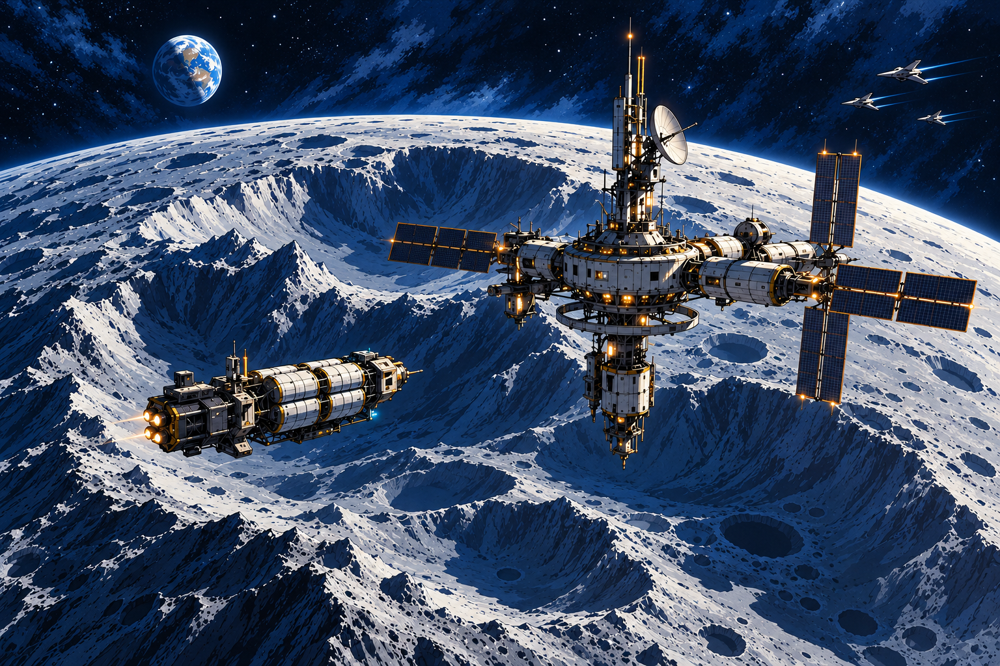

# Solar frontier and Galactic Democratic Compact

**Status (2026-10-24):** the title and pause menus open a compact Luna/Mars/Asteroid Belt/Kuiper Belt route chart. Each battle route runs ten saved, seeded space-battle levels; each battle contains three designed waves, Hive craft, Scalari fighter AI that changes flight behavior and silhouette, and heavy ships, with a level-10 Mother Ship and rescue/secure flag. Clearing Luna level 10 opens a surface landing on the supplied 16-bit lunar elevation map. The playable Selene Relay slice includes a buildable landing area, local iron/copper/lumen veins, a designed pressure-habitat and solar-array foothold, and a Hive cave network with a nest and loot. The same map and travel system make the Moon available from the local destination map after rescue. The asteroid mining route remains a playable space run; a persistent drone-supported asteroid base, Mars surface landing, full humanoid transformer animation, ship subsystem targeting and Compact voting remain future work. Future orbital construction follows the staged capability gates in [Project Helios](space-habitat-network.md); that plan distinguishes the rotating-habitat physics from unverified megastructure engineering.

## Campaign frame

The first political institution is the **Solar Assembly**, a provisional compact for settlements that need shared convoy protection, fusion-drive standards, open transit lanes, and enforceable civil rights. Its charter can grow into the **Galactic Democratic Compact** only when independent peoples vote to join. “Galactic” is the aspiration; the eight-planet Solar System is the first proving ground.

Two chambers balance population and place: an **Assembly of Citizens** elected proportionally, and a **Council of Worlds and Habitats** with protected seats for planets, moons, free ports, and mobile habitats. A measure needs a 60% quorum and approval in both chambers. Emergency fleet authority expires unless both chambers renew it, and civilian inspectors can audit every carrier, campaign expense, and detention order.

Earth's Arbor Frontier is the shipyard and founding hub. Pelaglass and Sonorous Reef gain distinct delegations rather than being folded into a single human seat. Mars controls its water and terraforming policy. The Galilean moons share convoy defense but retain local resource rules. Titan, Enceladus, and Gaia's protected Saturn-space orbit negotiate ring access and migration rights. Triton's Free Port chooses whether to join after its crisis. Mercury, Venus, and Uranus start with research, industrial, and habitat councils whose residents contest who pays for distant security.

The Compact is not a benevolent empire. Its story tests consent, unequal influence, extraction, migration, and civil liberty during wartime. Hive brood communities are liberated from the Scalari system and invited to make their own choices; they do not become Compact property. Scalari civilians and defectors have individual rights, while the Sovereign's command regime remains accountable for its attacks. Elections, public evidence hearings, negotiated membership, and local votes create playable outcomes alongside action missions.

## Solar-system destination roster

`src/procedural/SolarSystem.zig` records the canonical eight planet orbits. The figures are metadata in AU and f64; regional gameplay never uses these values as renderer coordinates.

| Planet | Destination | Campaign hook |
| --- | --- | --- |
| Mercury | Terminator Foundries | Twilight crater cities, solar furnaces, rogue industrial automation |
| Venus | Cloudhaven | Floating pressure habitats, rare cloud chemistry, labor and planet-protection treaty |
| Earth | Arbor Frontier | Canopy shipyard, human pressure domes, and fully submerged cetacean city |
| Mars | Ares Commons | Canyon farms and lava-tube neighborhoods debate water and terraforming rights |
| Jupiter | Galilean League | Europa, Ganymede, Callisto, and Io coordinate convoy defense and contested resources |
| Saturn | Ringward Assembly | Titan, Enceladus, ring access, Gaia's protected transfer orbit |
| Uranus | Blueglass Stations | Remote habitats face a failing thermal grid and prolonged polar night |
| Neptune | Triton Free Port | Independence vote coincides with an intercepted Scalari courier |

Gaia remains an artificial globe in Saturn space, not a ninth planet. The Hive/Scalari homeworld remains interstellar. Its distance is handled by the same strategic route clock; it is never placed millions of light-years away in f32 simulation coordinates.

Planned local-flight destinations include Luna; Phobos and Deimos; Io, Europa, Ganymede and Callisto; Titan and Enceladus; Titania and Oberon; and Triton. Each moon gets a bounded local region and a station/docking approach. The player selects a planet or moon from a chart, fast-travels there, then flies locally among its orbital landmarks. Surface landings are a separate heightmap-backed handoff. No continuous interplanetary flight, full orbit propagation, or absolute solar-system renderer is planned.

## Solar map and orbital activity before surface landings

Build the travel experience as three separate layers so the first space slice does not depend on planetary terrain:

1. **Solar chart:** choose a named system destination and fast-travel there. Show orbital bands and route lines as a navigable campaign map, not a physically scaled model. Include Mercury, Venus, Earth, Mars, Jupiter, Saturn, Uranus and Neptune; the main Asteroid Belt; and the Kuiper Belt beyond Neptune. Gaia is a special transfer-site icon near Saturn, while the Hive/Scalari homeworld is a separate interstellar campaign destination. Mars and the Kuiper Belt are explicit fast-travel choices. The current `SolarSystem.zig` catalog has only the eight planets and twelve moons, so the Asteroid Belt and Kuiper Belt need stable region IDs when implementation starts; neither is a new planet.
2. **Local orbital zone:** arrival loads a bounded flight/combat/mining space with stations, ships, salvage and authored asteroid fields. Planets and moons are illustrated image backdrops visible behind the local zone; they are not terrain or collision surfaces in this slice. Mars orbit can use its moon approaches and captured rubble pockets near Phobos and Deimos for asteroid work. The main belt and Kuiper Belt are larger repeatable mining regions, rather than implying that every orbit around every planet contains a mineable rock field.
3. **Surface landing:** after the orbital zone is proven, selecting a supported landing site hands off to its named surface level and heightmap. This is a later stage. The current solar-map and orbital design does not claim that Mars, the moons or other surfaces are landable.

| Chart node | Arrival scene | First activity |
| --- | --- | --- |
| **Luna orbit — South Pole Relay Orbit** | The polar relay, a small ice-hauling tender and a dock ring sit above Luna's cratered south pole; Earth is a distant landmark. | Escort the tender, scan an orbiting ice-rock pocket, and repel a small Hive drone patrol. This is a moon-side space location, not a surface landing. |
| **Mars system** | Ares Commons as a painted planetary backdrop; Phobos and Deimos establish near-field scale; Ares Beacon is the safe arrival point. | Survey a captured rubble pocket, recover an abandoned comm buoy, or intercept Hive scouts shadowing a civilian hauler. Selecting Ares Commons for surface landing is reserved for the next terrain step. |
| **Main Asteroid Belt** | Pallas Array, a compact rock cluster around a disabled tug and working beacon. | Scan and mine bounded deposits, tether the tug, and defend the operation against a Scalari hauler or a Hive raid. This is the first repeatable mining zone. |
| **Kuiper Belt** | A sparse outer-system zone of dark ice fragments, distant small-body silhouettes, a relay, and a convoy shelter. Neptune/Triton can be shown as a separate distant chart destination; do not imply the whole belt sits in Neptune orbit. | Find a silent prospector, recover its survey core, and hold the relay through a Hive swarm attack. Better mineral variety is balanced by longer extraction routes and fewer safe docking points. |
| **Planetary orbit nodes** | Each body uses a still or slowly animated illustration behind the playable flight arena, with a nearby station, moon or relay to establish scale. | Optional rescue, patrol, courier escort, or faction encounter. These are reusable encounter templates with local dressing, not a full orbital simulator. |

### Mining pockets

Generic asteroids are bounded encounter objects with authored resource classes, scan readings, stable site identity, and a small number of breakable seams. Scanning marks stable material and hazards; drilling frees a limited load; players tow or carry it to a local tender. Each pocket has one route challenge—rotating debris, a narrow tether passage, a cracked interior, or a hostile patrol—so repeat visits vary in approach without requiring infinite destruction or unbounded debris simulation. Mars' local examples are explicitly captured rubble near Phobos/Deimos; the plentiful mining loop belongs to the Asteroid Belt and Kuiper Belt.

### Asteroid-base and mining-drone operation

Build the belt base as the space extension of colony CM1 and the planned BS6/BS7 work, not as a parallel economy:

- Use the existing **iron, copper and lumen crystal** stockpile, shared colony clock, research points, power-satisfaction rule, and stable saved colony record. A player's hand-mined load remains personal until it is deposited; automated base output goes directly to shared stock.
- The first working base is a compact anchored cluster: beacon/landing cradle, power unit, extractor, store, drone bay, and one defensive module. Give each module an asteroid-rated prefab and readable tethers; reuse the existing drill, store, power, bay, shield/turret and launcher roles where their behavior fits. Do not place terrestrial blocks or gravity-dependent farm fields in vacuum.
- A **miner drone** surveys and drills a marked seam, then returns to the bay. A **hauler drone** transfers its canister to storage or the tender. The first pass uses CM4/BS6's bounded state-machine pool: nearby craft visibly travel and work; remote sites advance by hourly totals. Power, storage capacity, drone availability and damage limit production.
- The CM5/BS7 **command view** should inspect this same base and issue build, task, rally, repair and defense orders from the player's viewport. The orbital station's existing CM1 hourly yield is the placeholder contract; when a physical station/base is active, its site record becomes the source of that output so it cannot be counted twice.
- Use `Colony.Ore` for the first operational loop. Ice and volatile samples can appear as mission discoveries/data at first; adding new persistent resource kinds requires a deliberate save-format and economy pass rather than quietly converting them into ore.

Base defense should reuse the existing outpost raid, power, shield, turret, launcher and structure-health rules. Hive attacks can target tethers, stores, drones or the relay. A lost structure pauses output and creates a repair/reclaim mission; it does not erase the shared stockpile or the whole base. Keep one authored asteroid-base site as the proving region before adding free placement across the belt.

### Rising space-skirmish ladder

Each space location can offer replayable skirmishes whose seed fixes a fair enemy composition for that run. The campaign ladder climbs through ten battle levels. Levels 1–9 draw from the available locations and encounter templates with steadily more roles and coordinated objectives; difficulty grows through formations, target priorities and simultaneous tasks, not only by inflating enemy health. Scale attackers to the present local party, and keep a readable route to retreat/extraction.

| Level | Encounter escalation |
| --- | --- |
| 1 | Luna relay patrol: a small Hive drone flock tests flight and escort basics. |
| 2 | Asteroid tender raid: drones attack the mining tow while players hold a tether corridor. |
| 3 | Mars rubble sweep: scouts and a prospector contest the survey marker; protect the drone and recover its scan. |
| 4 | Kuiper relay ambush: two drone groups approach from separate vectors; keep the relay powered and extract. |
| 5 | Transforming-fighter intercept: one Scalari AI switches forms and attacks the convoy, then withdraws when damaged. |
| 6 | Mining-base defense: a Hive swarm pressures the store and drone bay while a battleship holds the long range. |
| 7 | Battleship engagement: disable weapon and engine systems under drone cover, or disengage with the cargo. |
| 8 | Mother Ship vanguard: break or bypass outer drone bays while keeping a civilian convoy intact. |
| 9 | Mars blockade: coordinate an assault on multiple Hive ships and shield relays to open a temporary corridor. |
| 10 | **Rescue Mars:** defend evacuation craft, disable the Hive Mother Ship's blockade systems, and secure an orbital rescue corridor. Success frees the planet's orbit and authorizes a Mars landing when the surface heightmap level is supplied; this mission does not fabricate or promise Mars terrain. |

Current behavior (2026-10-24; full design in [space combat](space-combat.md#space-battles-the-design-as-built-2026-10-24)): the four sectors form one route, and each opens when the previous sector's level 5 battleship falls. Each level is three authored waves of formations, harder by sector tier; level 10 is a three-phase Mother Ship. The fighter flies twin-stick (move and aim separately) with energy machine guns, a charge blast, tracking missiles and tracking energy bombs; enemies telegraph every attack and fire slow, dodgeable shots. Kills pay the pilot's own kit, a clear pays every present player and sets a shared flag, and level 10 sets the sector's rescue/secure flag; Luna's opens the Selene Relay landing. The asteroid mining run is played: the pilot shoots ore rocks into their own held ore, deposited at a colony store like any mined ore. It is not yet a placed, damaged, upgradeable base or a remote hourly drone simulation.

Mining is interrupted by readable decisions and pressure: a survey may reveal an unstable seam, an abandoned Scalari operation, or a crew member in danger. Players can secure the site, divert the machine, rescue workers, or extract the already-approved sample. A completed pocket returns material and data to a named station or settlement. This orbital loop leads into—not around—the surface survey, local consent and civic-build levels defined below.

### Hive fleet encounters

Space combat takes place in small local arenas around a convoy, relay, mining tender or capital ship. A typical encounter has a warning and approach, a readable drone attack, a larger fleet threat, then a defend/disable/extract objective. Asteroids, station struts and ship wrecks provide silhouettes and temporary cover; they are not a limitless particle field.

| Force | Battlefield role | Readable behavior |
| --- | --- | --- |
| Hive swarm drones | Numerous light attackers that pressure the convoy and mining crew | Arrive in small flocks, break formation when damaged, and regroup around a signal ship; individually fragile and easy to read. |
| Hive battleships | Heavy control ships that anchor the swarm | Hold distance, use broadside weapons, and launch drones. Disable engines or weapon nodes to create an extraction window; their armor remains too heavy for a quick solo kill. |
| Hive Mother Ships | Rare campaign-scale threats and set-piece bosses | Carry several drone bays and distinct exposed systems. The mission first protects civilians or a relay, then opens a timed boarding/weak-point opportunity, then extracts before the ship's last defense wave. Defeat or retreat changes the local route and salvage state. |
| Scalari transforming fighter AIs | Skilled autonomous interceptors, visually distinct from Hive swarm craft | Shift between fast flight and a compact humanoid combat mode to change attack range, dodge through debris, or contest a boarding point. Telegraph each change with a silhouette and charge-up; transformation does not grant invulnerability. |

The player Kestrel's planned vacuum form and winged Colossus remain separate progression. In orbit, all six native frames fly the bounded twin-stick model with their own handling and weapon profile (the fighter designer on the solar map). Armada transformers switch between robot fighter and lancer silhouettes, winding up and dashing in lancer form; they do not transform to a humanoid mesh. Ship subsystems, convoy objectives and retreat extraction remain planned.

### Build order for the space layer

1. **In place:** title/pause route chart; bounded orbital launch; four sectors of ten saved levels with route gates, telegraphed enemy fire, four weapon systems, six designer frames and a three-phase Mother Ship; a played asteroid mining run into each pilot's held ore; the Selene Relay landing after Luna.
2. Add the broader chart destinations, including Kuiper Belt travel, and connect the orbit-secured flags to an explicit landing-site selection.
3. Turn the prototype mine into a persistent asteroid base with survey seams, miner/hauler tasks, storage capacity, power, damage and player commands, reusing colony research and site records.
4. Add active enemy fire, convoy/relay defense and retreat/extraction outcomes; give battleships and Mother Ships readable subsystems before adding larger fleets.
5. Add Scalari fighter transformation behavior only after the current orbital targeting and combat reads clearly.
6. Add surface-site selection and heightmap landing, beginning with Mars. Each landing loads a bounded named region rather than dropping into a planet-scale continuous world.

The map and orbital slice uses illustration assets only for planet backdrops. The owner plans to supply surface heightmaps for the subsequent landing step; no open-source planetary image, scientific texture or heightmap is assumed in this design.

## Level designs: first Solar prospecting arc

These are bounded mission regions reached from the Earth shipyard by strategic travel. Each should feel like a place people live and make decisions, not a resource node with enemies around it. A level targets a 1.3–1.7 km playable region, two or more routes into its central problem, 4–8 readable landmarks, optional discoveries, an extraction/docking point, and a few legal construction sites. Moons are distinct landing zones within their parent planet's campaign chapter; they do not require building an entire globe. The first route establishes the survey → consent → small resource demonstration → useful civic infrastructure pattern before any large industrial expansion.

**Earth is the home hub, not a mining chapter.** After the Detroit liberation arc, Crown Harbor at the Arbor Frontier becomes the shipyard, expedition briefing point, fabrication bay, and first Solar Assembly meeting hall. Players use its existing city and wilds loop to prepare for Luna. Returning expeditions visibly add route beacons, service modules, and representatives to the harbor. The Solar levels do not replace or bypass Earth's city liberation campaign.

| Order and level | Local layout and traversal | Main conflict and mission beats | First civic build and lasting outcome |
| --- | --- | --- | --- |
| 0. **Luna — South Pole Relay** | Shackleton crater rim, a shadowed ice trench, a pressurized transit hub, and a short lava-tube service route. A ridge approach is fast but exposed; the tube reaches the relay from below. | Follow a missing water survey crew; scan three ice exposures; shut down a Scalari drill that has breached the reserve perimeter; escort the crew and samples to the public hub. | Repair a shared water/communications relay. The settlement publishes the ice map and its reserve boundary; no extraction starts until local water users set a quota. This teaches the expedition verbs and stakes without making Earth a mining tutorial planet. |
| 1. **Mercury — Terminator Foundries** | A crater settlement straddles the twilight band. The sunward solar-furnace field, a shaded rail trench, and a buried observatory make three distinct routes. Heat exposure rises toward the furnace field and recedes in the crater shadow. | Investigate a silent automation shift; restore the observatory's safe route; trace a Scalari command key through maintenance machinery; disable the rogue stripping schedule while keeping the power array online. | Build a public power-and-comms mast from salvaged solar glass. Residents retain the furnace controls; recovered machine data unlocks a safer prospector design. |
| 2. **Venus — Cloudhaven** | A chain of buoyant pressure habitats, maintenance balloons, and a suspended chemistry deck above the cloud layer. Interior pressure locks link the upper route; a lower service gantry is quicker but crosses a storm front. | Rescue a drifting filter barge; survey a rare cloud-chemistry plume; discover that Scalari extractors have diverted habitat filters, worsening a local pressure emergency. Choose a rescue and repair order under time pressure. | Restore a shared filter works and add a storm mooring. Chemistry access stays behind a resident-approved environmental and labor treaty; the mission does not propose surface terraforming as an immediate payoff. |
| 3. **Mars — Ares Commons** | Canyon farms, a dry aquifer cut, two lava-tube neighborhoods, and an old landing pad. Players can follow the exposed canal or descend through a tube to reach the buried pump station. | Survey three aquifer readings; compare them with the farms' published water ledger; stop a Scalari prospector convoy before it maps the reserve; defend a controlled test pump while residents audit its output. | Build a metered pump, a pressure-safe habitat module, and a landing beacon as one small demonstration. The Commons votes among farm reserve, habitat growth, or a split schedule; the chosen allocation visibly changes canal flow and which district gets power first. This is the first complete survey-to-settlement level. |
| 4. **Asteroid Belt — Pallas Array** | A loose cluster of fractured rock around a disabled tug and beacon. The anchor rock has a sheltered tunnel through its center; the exposed ridge holds the richest visible seam. Local flight links three small rocks and the tug, keeping the playable space bounded. | Locate the missing tug crew; use a survey charge to distinguish stable seams from fractured, spinning material; repel a Scalari hauler; extract only the marked load. Mining blasts can break authored rock sections and open or close short routes, but do not destroy the whole asteroid or simulate orbital debris. | Establish a beacon, tether points, and a tug repair cradle before a permanent extractor. The crew chooses a conservative seam and logs an exclusion zone around the unstable cluster; later missions can revisit it without resetting its state. |
| 5. **Jupiter / Galilean League — Europa's Under-Ice Commons** | A heated surface dock, a crevasse lift, a research gallery, and an under-ice water tunnel. The safe route follows shielded stations; a short cut crosses an exposed ice shelf during a plume cycle. | Stop a Scalari drill before it breaks a protected ocean boundary; rescue the local inspection team; divert power from a weaponized cutter to the treaty sensors; expose the forged survey permit. Combat pressure comes from defending routes and disabling equipment, not from treating the ocean as loot. | Build a buffer relay and repair a public sensor line. The League keeps ice access local and funds a separate, small service quarry away from the protected boundary. Mission evidence can later influence the League's shared convoy rules. |
| 6. **Saturn — Titan's Methane Reach** | A methane-shore port, a low bridge over the sea, a thermal plant, and a hauler route through orange dunes. Surface and platform routes converge at the heat-exchange station. | Keep a hauler convoy moving while Scalari machines divert methane from the habitat grid; investigate why the droids are following an obsolete labor quota; free trapped workers and decide whether to reassign or dismantle the machinery. | Repair a heat relay, then add a worker-controlled landing and repair pad. Residents approve the extraction shift schedule; methane output rises only if the heat and labor plan can support it. Gaia remains a separate protected habitat project in Saturn space, not a mine or a Titan district. |
| 7. **Uranus — Blueglass Stations** | Two remote stations linked by a surface service road and a short low-gravity exterior route. Titania's Crown Ice Works supplies the thermal relay; Oberon's Outer Crater Port is the optional relief landing and alternate extraction path. | Restore the failing thermal grid before the polar-night reserve runs out; split the group between the relay and a stranded survey crew; find the Scalari cache that has been drawing emergency power. | Connect a redundant thermal relay and repair a public shelter. The stations decide whether the next shipment serves research instruments or habitat reserves; both options preserve life support but change the next expedition's available data and services. |
| 8. **Neptune — Triton Free Port** | A sheltered crater port, a nitrogen-ice field, a long radio ridge, and a compact courier landing scar. The ridge gives line of sight to the incoming ship; a lower ravine is a safer civilian evacuation route. | Keep the Free Port's vote open while an intercepted Scalari courier approaches; verify whether the message is a threat, a defection request, or both; protect the port and prevent either side from coercing the vote. | Repair the port's independent communications and public assembly hall. Residents choose Compact membership, a defense-only treaty, or continued independence. Each leaves local control intact; a refusal to join remains a successful outcome and does not lock the route. |

### Moon landing zones

The moon locations are authored sub-levels with one defining traversal problem and one resource/civic question. They can branch from their parent chapter after the initial route is proven.

| Moon level | Distinct playable hook |
| --- | --- |
| Luna — South Pole Relay | Shared ice reserve and public transit; survey and communications before extraction. |
| Phobos — Stickney Dockyards | Low-gravity shipyard gantries; protect a repair crew pressured to build Scalari-compatible drills. |
| Deimos — Far Lantern | Relay outpost; follow a prospector swarm's aquifer map and decide who receives the survey. |
| Io — Sulfur Arc | Volcanic crawler field; route through cooling shelters to shut down a dangerous extraction shift. |
| Europa — Under-Ice Commons | Treaty-protected ocean boundary; stop a cutter and build a sensor buffer. |
| Ganymede — Magnetosphere Works | Shielded port and magnetic research district; defend a convoy while residents vote on shared protection. |
| Callisto — Quiet Crater | Neutral repair station; uncover a buried Scalari cache without collapsing the occupied service tunnel. |
| Titan — Methane Reach | Shoreline hauler route and thermal grid; extraction must not starve habitat heat. |
| Enceladus — Geyser Fields | Plume-side research camp; redirect ice prospectors away from a biosphere exclusion zone. |
| Titania — Crown Ice Works | Remote quarry and thermal relay; restore power during the Blueglass chapter. |
| Oberon — Outer Crater Port | Independent port and relief landing; choose whether to accept outside aid without surrendering local authority. |
| Triton — Free Port | Public membership vote, courier interception, and a safe evacuation ravine. |

### Mining and settlement through the arc

Use one readable operation per level rather than a passive planet-wide production simulation. A survey identifies a resource and its civic or ecological boundary; a local crew authorizes a bounded test; players secure or repair the equipment; the settlement chooses what the first output supports. Physical mission rewards should be specific materials and data, while long-term output belongs to a named, powered site that can be defended and revisited. A successful defense should create a supply or repair opportunity; losing an extractor should create a reclaim mission, not erase the colony.

Keep the Scalari prospector legible as industrial equipment with a job: scan, drill, store a small load, and call for help if attacked. The first set of encounters should ask players to disable, redirect, or negotiate access to a site. Destroying a machine is available when necessary to protect people, but it should not be the only interaction. The settlement's consent, labor safety, reserve limits, and local ecological rules must shape what can be built next.

The asteroid level's destructible seams are authored pieces with bounded debris and stable mission IDs. They open routes and reveal deposits; they do not imply a system-wide fracture simulation. Habitat construction follows [Project Helios](space-habitat-network.md): prove communications, power, thermal control, cargo handling, and repair before adding a permanent crewed habitat. A player-visible structure or service should change at the end of each level so civilization-building reads through the environment, not only through a resource counter.

Candidate settlement arcs grow from prospecting and a landing/communications outpost into a local resource demonstration, a modular station, and then connected city districts where the site's resources, climate and logistics justify them. This is not a promise that every planet or moon has an economical mine or that every settlement becomes a city. Across the campaign, settlements may join into futuristic city-planets: connected urban belts and sealed surface, subsurface or orbital habitats adapted to each world's conditions. Terraformation is staged by regional projects and public votes, not an instant planet-wide toggle. Venus begins with floating pressure habitats; upper-atmosphere processing, sealed surface habitats, and long-term climate intervention remain separate speculative steps with resident consent and ecological consequences as mission choices.

### Gaia's printed city-world

Gaia establishes the campaign's signature habitat-building language: early industrial pressure infrastructure fused with robotic additive construction and deliberately integrated ecology. The silhouette layers huge fabrication halls, orbital cargo docks, foundries, cranes, pipe bridges and steel service gantries beneath a growing geodesic shell. Brass/copper valves, analog dials, enamel identifiers and riveted maintenance access give the industrial layer a tactile, early-steampunk ancestry; the pressure boundary and load-bearing structure remain visibly advanced printed composite, ceramic, glass and alloy. Forest canopies, agricultural terraces, wetlands and waterways fill planned shell cells and connect to life-support systems, so green space reads as essential civic infrastructure.

Treat each builder swarm as a readable, modular crew rather than background particle noise: survey, frame-print, panel-skin, inspect/repair and feedstock-haul roles have visible tools and a shared cell-level work target. A district grows through bounded modules that can be inspected, defended and repaired. Missions can restore the yard's power/feedstock, change the build queue, escort a haul, rescue stranded repair bots, or defend an exposed print crew; completion adds a traversable structure or service and can shift which civic needs are met first. Keep the visual composition grand and painterly, with saturated planetary dawns, warm furnace light and cool shell shadows, evoking the scale and earnest wonder of 1980s space epics through original Heavy Water shapes. This makes Gaia an industrial proving ground for station and habitat construction across the other worlds. It remains a design target until a local build site is playable.

## Fusion-pulse travel

Ship blueprints gain a **fusion-pulse drive** with a fictional strategic cruise rating of **0.5c**. It powers fast-travel transitions on the campaign chart; there is no continuous interplanetary cruise scene or orbit simulation. Within a planet/moon region, ships retain readable local m/s handling, can fly to orbital infrastructure, and dock at or build stations. Transit time can compress to a short departure/arrival sequence while leaving route choice, hazards, defense, and resource cost meaningful. The 0.5c rating is fictional game technology, not a claim about real fusion engineering or the transfer speeds used in the science-grounded habitat plan.

## Scalari mining droids

Scalari extraction fronts appear across the system because their off-world expansion is much older than Earth's colonies. Start with the light **Talus-class Prospector**: a four-legged, wing-finned machine with a swiveling sensor crest, paired drill arms, and a removable resource canister. It avoids fights, scans deposits, drills at a modest rate, and calls a guard unit if attacked. A separate hauler carries ore to a landing tender; neither is a combat robot in disguise. The current data contract sets the starter prospector to 45 health, four abstract resource units per minute, and only 2 defense damage. Its first mission verbs are scan, disable the drill, free trapped workers, and choose whether to seize or shut down the operation.

Use original high-energy transforming-mecha anime design language: bold readable silhouettes, articulated transformation joints, swept flight surfaces, layered mechanical armor, luminous reactor pathways, expressive posing, strong cel-shaded light/shadow blocks, and painterly planetary skies. Give the Kestrel a winged Colossus form with its own proportions and transformation logic. Scalari machine design should feel alien and industrial, with its own scale-like panels and sensor language.

## Kestrel transformation slice

Keep one saved ship, one damage state, and one crew across three mechanically distinct forms:

1. **Atmospheric jet:** the existing aerodynamic Kestrel, VTOL, afterburner, cannons, and missile lock.
2. **Vacuum interceptor:** wings articulate into a tighter radiator/drive posture; fusion pulse provides campaign fast travel, while local planet/moon flight and dogfights retain the fixed-step 6DOF flight computer and weapons.
3. **Winged Colossus:** the same Kestrel unfolds into a tall humanoid combat silhouette that keeps its swept wings, tail fins, canopy core, and twin pulse-drive back vents. Ground movement, jumps, melee, and ranged hardpoints require a dedicated mech controller, collision profile, animation, and readable attacks; this must not be represented as only a scaled-up jet mesh.

Transformations are explicit, interruptible state transitions. A selected form cannot bypass hull damage, weapon cooldown, or mode-specific exposure. The player can transform in flight with enough clearance; a landing transition checks room before changing collision shape. Transformation power comes from one heat/energy budget shared with drive boost and weapons. Start with the Kestrel only, then make ship modules and alternate chassis after the full Kestrel loop is playable.

## Delivery order

1. Surface the eight-planet/twelve-moon roster in a local campaign chart. Select a body, fast-travel there, and fly a bounded local region.
2. Build the first local dock and service station after the Earth liberation loop; add power, communications, cargo handling and repair before habitation. Keep later mining, refinery, greenhouse and habitat pieces behind site surveys, resource processing, thermal and life-support gates. Use the ordered habitat sequence in [Project Helios](space-habitat-network.md).
3. Bring the Prospector mining droid into one Scalari site with scan/drill/disable behavior, resource output, a readable vulnerability, and a mission result.
4. Add the Solar Assembly / Compact charter, representatives, public decision outcomes, and visible membership and crisis states.
5. Build Kestrel form states and a timed transform animation with continuity for position, attitude, hull, heat, and weapons.
6. Create the winged Colossus mesh, collision shape, locomotion, and melee/ranged combat. Prove one transformation, fight, and return-to-flight loop.
7. Add Venus's first staged terraforming project and expand one mining camp into a station/city district; repeat the modular contract around other worlds and moons.
8. Add the vacuum-interceptor camera/HUD and fast-travel arrival sequence for a destination. Continue the Scalari interstellar arc and Compact membership choices.

Acceptance for the first colony slice: fast travel selects a planet or moon; local flight reaches a station dock; a powered mining bay records output; one Scalari Prospector scans/drills and can be disabled; an upgrade/build choice persists; settlement autonomy affects the democratic charter. Acceptance for the first transforming-ship slice: all forms share one persistent Kestrel identity and hull; form switches preserve velocity safely; blocked mech deployment leaves state unchanged; robot mode supports terrain movement, jump, one melee attack and one ranged attack; returning to flight works; visual capture and Metal validation show folded, transition, and winged-mech silhouettes; a headless test covers each state transition and failed clearance.
